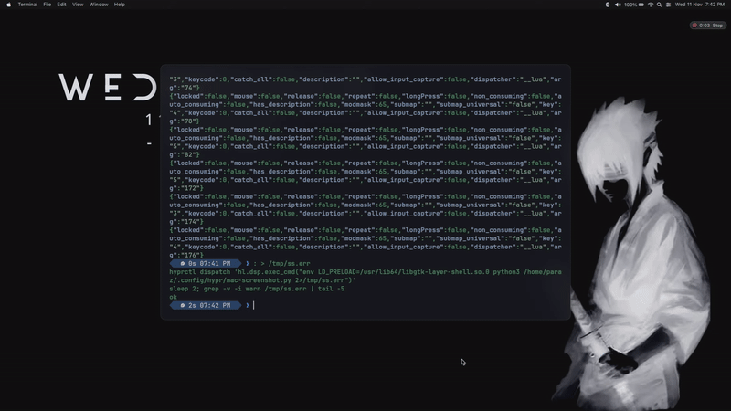

# 🧞 Genie for Hyprland

The macOS **Genie effect** for [Hyprland](https://hypr.land): windows bend into a funnel and pour into their Dock icon when you minimise them, and pour back out when you restore them or open an app.

It's a native Hyprland plugin written in C++. It draws the window as a few hundred thin strips, bending each one along an S-curve toward the icon.



## Features

- **Minimise:** the window is pulled into **its own Dock icon**, not just the bottom of the screen.
- **Restore:** it pours back out to exactly where it was.
- **Open:** new app windows pour out of their icon.
- **The app's own buttons work too.** A title-bar minimise button (yellow traffic light) triggers the Genie. Plain Hyprland tells apps it can't minimise, so GTK 4 / libadwaita apps hide or disable that button; Genie tells them it can, so the yellow button works everywhere.
- **Slow motion,** like the old macOS Shift-click trick: `GENIE_SLOW=1 genie-minimize`.
- **Adjustable speed:** `hyprctl genie duration 0.4`.
- **Safe to unload.** If the plugin isn't loaded, the scripts still minimise and restore, just without the animation.

## Requirements

- **Hyprland 0.56 or newer, with a Lua config (`hyprland.lua`).** Genie uses the Lua dispatchers, so the old `hyprland.conf` format isn't supported.
- **Hyprland's development headers.** On Fedora: `sudo dnf install hyprland-devel glslang-devel`.
- `g++` with C++26 support, plus `make`, `pkg-config`, `jq` and `socat`.
- A Dock at the bottom of the screen. Icon positions are computed for [nwg-dock-hyprland](https://github.com/nwg-piotr/nwg-dock-hyprland). With any other Dock, or none, Genie aims at the bottom centre.

Tested on Hyprland 0.56.2 (Fedora 44).

## Install

```bash
git clone https://github.com/parasharkhangembam-ctrl/hypr-genie.git
cd hypr-genie
./install.sh
```

The installer builds the plugin and copies it, with four small helper scripts, into your home folder. It doesn't use `sudo` and doesn't edit your config. Run `./install.sh` again after **every Hyprland update**, because a plugin has to be rebuilt for each Hyprland version. Genie refuses to load if it was built for a different version.

## Set up

Add these lines to `~/.config/hypr/hyprland.lua`:

```lua
-- Genie: load the plugin and the "open" effect at login
hl.on("hyprland.start", function()
    hl.dispatch(hl.dsp.exec_cmd("sleep 2; hyprctl plugin load $HOME/.local/share/hypr-genie/genie.so; $HOME/.local/bin/genie-events"))
end)

-- Super+M minimises, Super+Shift+M brings the last window back
hl.bind("SUPER + M",         hl.dsp.exec_cmd("$HOME/.local/bin/genie-minimize"))
hl.bind("SUPER + SHIFT + M", hl.dsp.exec_cmd("$HOME/.local/bin/genie-restore"))
```

Then run `hyprctl reload`, and load it once by hand (or log out and back in):

```bash
hyprctl plugin load ~/.local/share/hypr-genie/genie.so
```

**Dock icon size:** if your Dock doesn't use 48 px icons with an 8 px bottom margin, tell Genie by setting `GENIE_DOCK_ICON` and `GENIE_DOCK_MARGIN`, e.g. with `hl.env("GENIE_DOCK_ICON", "62")`.

**Clicking a Dock icon to restore:** point your Dock's click action at `genie-restore <window address>`.

## Commands

| Command | What it does |
|---|---|
| `genie-minimize [ADDR]` | Genie the focused window (or `ADDR`) into its Dock icon |
| `genie-restore [ADDR]` | Bring back the last minimised window (or `ADDR`) |
| `hyprctl genie duration 0.4` | Set the speed in seconds (0.15–3). With no number, it prints the current speed |
| `hyprctl genie status` | Version, running animations and speed |
| `hyprctl genie minimize\|restore\|open\|close [0xADDR] [x y w h] [slow]` | The low-level commands the scripts use. `x y w h` is the icon's rectangle in layout pixels |

Minimised windows go to the special workspace `special:minimized`.

## How it works

1. Genie takes a snapshot of the window, the same kind Hyprland uses for its close animation, and hides the real window.
2. Each frame, it draws the snapshot below the Dock as many thin horizontal rows. [`genie_math.hpp`](genie_math.hpp) works out where each row goes and which band of the window it shows, in two overlapping phases:
   - **Phase A:** the bottom edge is pulled into the icon while the sides bend into a funnel.
   - **Phase B:** the whole window pours down the funnel and is squeezed into the icon.
3. When it finishes, the real window is moved to (or back from) `special:minimized`.

The maths is pure C++ with no Hyprland types, so it has unit tests: `make test`.

## Uninstall

```bash
./install.sh --uninstall
```

Then remove the Genie lines from your `hyprland.lua`.

## Troubleshooting

- **"built for a different Hyprland version":** run `./install.sh` again.
- **Nothing happens:** check that `hyprctl genie ping` prints `ok genie …`. If not, load the plugin (see Set up).
- **It aims at the wrong icon:** set `GENIE_DOCK_ICON` and `GENIE_DOCK_MARGIN` to your Dock's values.
- **The build fails:** the plugin API changes between Hyprland versions. Open an issue with your `build.log` and `hyprctl version`.

## Credits

Made by **Parashar Khangembam** as part of building a macOS-style desktop on Hyprland from scratch, written with help from Claude (Anthropic). The two-phase approach follows Harshil Shah's write-up *"Recreating the Mac genie effect"* and BCGenieEffect.

MIT licence, see [LICENSE](LICENSE).
